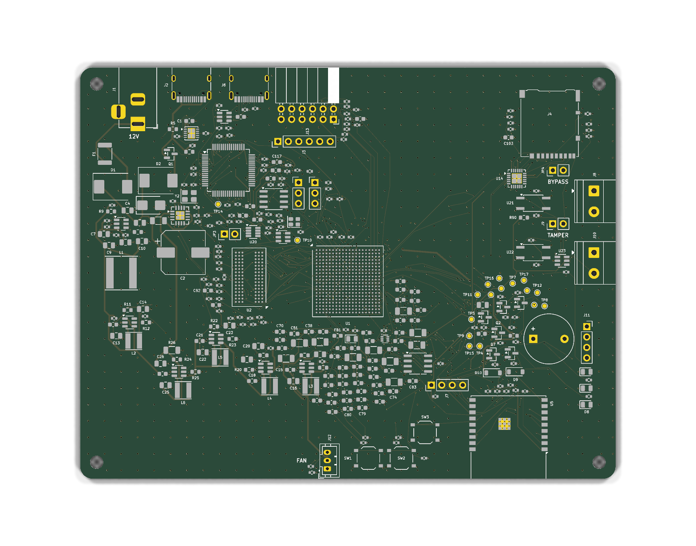

# OFE trader board (rev A)

A custom Zynq-7020 board built as the hardware side of a crypto trading system: the ARM cores run
the trading jobs, the FPGA keeps live order books and an independent hardware risk gate, and a
physical arm key and E-stop gate every order.

## Hardware
| | |
|---|---|
| SoC | Xilinx/AMD **XC7Z020-1CLG400C**: dual Cortex-A9 + Artix-7-class FPGA, 400-ball 0.8 mm BGA |
| Memory | **512 MB DDR3L** (MT41K256M16TW-107), 1.35 V, point-to-point x16 |
| PCB | **6 layers**, 130 x 100 mm, 1.6 mm, JLC06161H-1080 impedance stackup, via-in-pad (epoxy filled and capped), ENIG |
| Boot / storage | microSD (Linux runs from a high-endurance card) |
| Network | ESP32-C3 Wi-Fi module |
| Programming | **FT2232HL** on USB-C: JTAG (Vivado Hardware Manager) + UART console on one cable |
| Trading controls | E-stop and arm-key terminals, OLED socket, status LEDs, buzzer, bypass jumper |
| Expansion | PMOD host port (GPS PPS for hardware timestamps, ADCs, displays ...), I2C |
| Power | 12 V barrel jack with reverse-polarity protection, sequenced rails for the Zynq and DDR3L |

## Release checks (14 Nov 2026)
- KiCad DRC: **0 errors, 0 unconnected** on 6 layers; schematic parity **0**
- DDR3L timing: **PASS**: worst address/command +94 ps vs CK, worst DQ +32 ps vs DQS (limit +-100 ps)
- Remaining warnings are cosmetic (silkscreen near the board edge, one copper sliver)

## Files
| File | What |
|---|---|
| `release/ofe_trader_revA_JLCPCB_Gerbers.zip` | Gerbers + drill, upload to JLCPCB |
| `release/ofe_trader_BOM_JLCPCB.csv`, `release/ofe_trader_CPL_JLCPCB.csv` | JLCPCB assembly BOM and placement |
| `release/ofe_trader_BOM_full.csv` | full bill of materials with LCSC numbers |
| `release/README_ORDER.md` | every JLCPCB setting and why |
| `release/HAND_SOLDER.md` | through-hole parts to solder by hand |

## Status
Rev A released, not yet built. Planned for rev B: eMMC, QSPI boot flash, wired Ethernet with
hardware timestamping, RTC.
